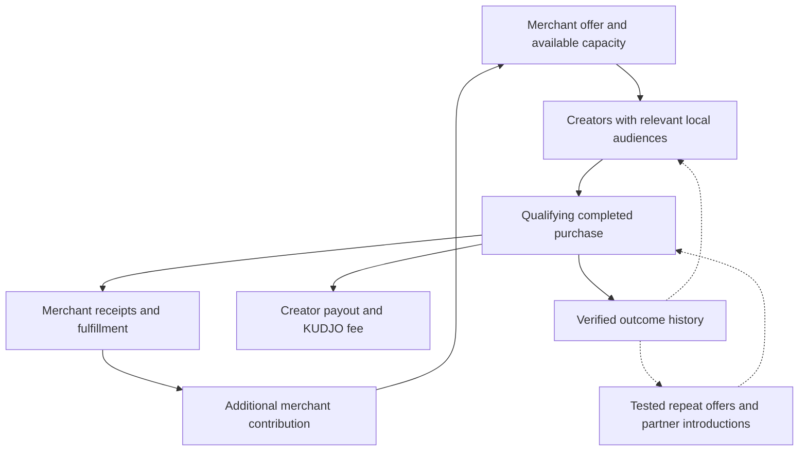
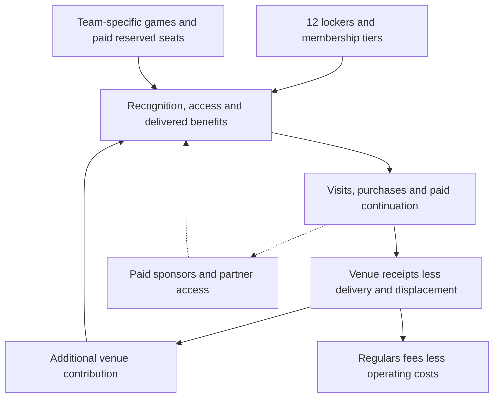

# KUDJO and Regulars: investor research and validation dossier

Prepared for Devon A. Dudley • 7 October 2026 • Expanded 8 October 2026

## The investment theses

**KUDJO thesis 1 — Local customer acquisition:** Nearby creators with relevant audiences can generate profitable new-customer purchases for local merchants. Charging merchants on qualifying completed purchases can reduce their upfront promotion exposure, provided creators participate and platform costs fit inside the fee.

**KUDJO thesis 2 — Learning and coordination:** Verified purchase and repeat-visit results can improve offer selection and partner campaigns. The eventual advantage must be demonstrated through better incremental contribution and more efficient delivery, rather than asserted because the company collects data.

**Regulars thesis 1 — Experience-led retention:** Recognition, dependable service, community and meaningful access can make a venue worth returning to. A bottle locker is the initial tangible membership benefit; the broader product includes membership tiers, team-specific game-day experiences and reserved seats.

**Regulars thesis 2 — Monetizing demand:** When the experience has demonstrable demand, a venue can sell memberships, bottles and reservations, then potentially sponsorships and partner access. Revenue must exceed fulfillment, displacement and program costs; audience size alone does not guarantee advertiser income.

## Executive assessment

The strongest current support is for the mechanisms behind the concepts. Evidence does not establish our exact prices, two bottles per locker each month, four buyers per creator, commission-only creator participation, profitable bar-seat pricing or sponsorship yield.

KUDJO has a credible acquisition hypothesis, but an investor will ask why merchants and creators need it instead of direct arrangements or established booking platforms. Its most material risks are incremental sales measurement, thin contribution after creator payouts, merchant/creator retention, distribution access, and customers bypassing the tracked channel on subsequent purchases.

Regulars has particularly relevant support from research on service relationships. Its key risk is operational: the benefit has to exist during an ordinary shift, not just during a founder-supported launch. The venue must earn additional contribution, and delivery effort must permit an economically viable platform fee.

**Recommendation:** Validate a narrow, manually operable product for each. Do not make future advertising, AI superiority, automated personalization or network effects necessary for pilot success. Treat those as separate expansion hypotheses.

## Research method and evidence boundaries

This is a targeted research synthesis, not an exhaustive systematic review. It combines scholarly publisher pages, university research repositories and author summaries; original consulting and industry reports; and first-party product documentation for competitors. Search included supporting and disconfirming evidence on local influence, creator economics, service relationships, loyalty, advertising incrementality, offer targeting, venue experiences and operating margins.

The bibliography contains 29 selected sources. Publisher abstracts and accessible author summaries were used when full papers were unavailable. These entries are not represented as full-methods audits. Industry association research has commercial interests; consulting surveys and vendor performance claims are not randomized experiments. No sample-to-population transfer is assumed.

Evidence hierarchy used here:

1. Randomized field evidence is strongest for a narrowly specified causal effect.
2. Meta-analyses summarize a wider literature, but inherit variation in outcomes and study quality.
3. Observational sales evidence is useful commercially but may not establish incrementality.
4. Consulting and industry surveys establish reported preferences, market context and practitioner problems.
5. Vendor documentation establishes competing capabilities and terms; it does not independently establish ROI.
6. Our forecasts and proposed experimental gates are management assumptions, not external findings.

## KUDJO: supporting evidence, counterevidence and implications

### Locality is a defensible selection criterion

**[S1] Todri, Adamopoulos and Andrews, Journal of Marketing, 2022.** The study links geographic proximity between recommending users and exposed followers with subsequent purchasing, using visibility variation and additional controls. The publisher abstract reports robustness analysis drawing on a corpus of 140 million messages. This supports checking audience proximity, not simply an influencer's home address. Setting: Twitter recommendations and retail purchases. It does not establish local service conversion rates. Access: publisher abstract and authors' AMA explanation.

**Our inference:** Recruit by reachable local audience, relevant service interest, credibility and ability to produce useful content. Obtain aggregate audience-location evidence when available. A locally based creator with mostly distant followers may be a poor fit.

### Smaller creators can be economically useful—but not in every setting

**[S2] Beichert, Bayerl, Goldenberg and Lanz, Journal of Marketing, 2024.** The work examines approximately 1.88 million sold products and three field studies involving 319 paid influencers. Smaller influencers produced superior ROI in the studied direct-to-consumer settings. Access: publisher full text and authors' AMA summary. This is unusually relevant because it considers revenue and costs rather than engagement alone. It does not prove commission-only creators will join, or that results generalize unchanged to local appointments.

**[S3] Barari, Eisend and Jain, Journal of the Academy of Marketing Science, 2026; online 2025.** A meta-analysis of 135 experimental studies from 71 papers found human social-media influencers relatively more effective than virtual influencers, celebrities and brand posts for the engagement and purchase-intention outcomes analyzed. Influencer size moderated results. Access: open-access publisher material. This challenges an assumption that AI presenters will outperform human creators. It does not directly establish completed-sale economics for our product.

**[S4] Pan and colleagues, Journal of the Academy of Marketing Science, 2025; online 2024.** The review synthesizes 1,531 effect sizes from 251 papers, distinguishing nontransactional and transactional outcomes. Communication, credibility, content, audiences and product/platform context matter. Access: open-access publisher material. This supports careful campaign matching while arguing against a universal sales rate based on follower count.

**Our inference:** Human local creators, merchant footage and clearly identified AI presenters are alternative distribution/creative approaches to compare. An AI character has no inherited audience. Production savings must be tested together with cost per completed purchase.

### Attributed purchases are not the same as purchases caused by the campaign

**[S5] Blake, Nosko and Tadelis, Econometrica, 2015; NBER version 2014.** Large eBay field experiments found paid-search returns substantially below conventional observational estimates; branded search had no measurable short-term benefit in that setting. Access: NBER summary. This concerns search, not creator campaigns, but directly challenges treating tracked transactions as incremental transactions.

**[S6] Gordon and colleagues, Marketing Science, 2019.** Fifteen Facebook advertising experiments included 500 million user-experiment observations. Observational models often failed to recover randomized estimates even with extensive behavioral and demographic controls. Access: university research abstract. This supports holdout experiments and careful language about attribution.

**Our inference:** Maintain two reports: verified purchases attributed under contract rules, and estimated incremental purchases/contribution from experiments. Do not label all first-report revenue as incremental growth.

### Targeted offers can work; the profitable mechanism needs testing

**[S7] Sahni, Zou and Chintagunta, Management Science, 2017.** Seventy randomized experiments at an online ticket-resale platform found promotional email increased spending, with most gains occurring without offer redemption. Access: Stanford author summary. The finding supports testing reminder/advertising effects alongside discounts. It does not establish a 37.2% lift for KUDJO or a universal discount threshold.

**[S9] McKinsey, personalization report, 2021.** Reports 71% of consumers expect personalized interactions and describes commonly observed 10–15% revenue lifts. Access: consulting article. This supports the relevance of personalization, not a guaranteed causal effect for our merchants. Comparative company performance may reflect broader differences in execution.

**[S22] Edelman, Jaffe and Kominers, Harvard working paper, 2014.** The theoretical discount-voucher model highlights narrow profitability conditions, including marginal costs, customer price sensitivity and whether discounts reach buyers who would otherwise pay full price. Access: full working paper. This is a counterargument to indiscriminate discounting, not proof that our offers fail.

**Our inference:** Optimize incremental contribution per eligible customer over a defined window. Compare no contact, a reminder without a discount, and a margin-safe offer. Observe purchases that occur without redemption too.

### Partnerships are plausible; a local referral network remains unproven

**[S8] Schmitt, Skiera and Van den Bulte, Journal of Marketing, 2011.** Tracking roughly 10,000 German bank customers found referred customers had at least 16% higher average value than comparable nonreferred customers, with higher retention. Access: university-hosted paper. This motivates referral tests but is not direct evidence for cross-merchant beauty/restaurant campaigns.

**Our inference:** Test a few complementary pairs. Count redeemed introductions, destination margin, origin payout and repeat use. A relationship between two businesses is not itself a network effect. Show that additional useful partners improve participant outcomes without equivalent increases in operating effort.

### Industry context and competition

**[S17] IAB, Creator Economy Ad Spend and Strategy Report, 2025.** The trade association projected $37 billion in intentional U.S. creator advertising spend for 2025 and identified audience alignment, creator selection and measurement as concerns. Access: original release and methodology description; the large report PDF could not be fully retrieved here. The figure describes broad creator advertising, not KUDJO's serviceable market.

**[S18] IAB, As-Is Measurement Landscape, January 2026.** Describes fragmentation in creator metrics, pricing and verification. Access: original report landing-page summary, not full report. This identifies a practitioner problem; it does not prove merchants will pay us to solve it.

**[S20] Booksy Boost, U.S. help documentation.** Describes first-visit acquisition commissions, generally 30%, with minimum/maximum fees and no Boost commission on later visits. Access: current official documentation. This is competitive precedent, not a research study. Booksy also has a broader product relationship; do not imply its entire service has zero subscription cost.

**Investor implication:** Position KUDJO around creator-driven local distribution, auditable acquisition and demonstrated merchant economics. “Pay for new customers” alone is not a unique proposition.

## Regulars: supporting evidence, counterevidence and implications

### Recognition and reliable relationships are the strongest foundation

**[S10] Gremler, Van Vaerenbergh, Brüggen and Gwinner, Journal of the Academy of Marketing Science, 2020.** The meta-analysis integrates 1,242 effect sizes from 235 independent samples across 224 papers. Confidence and social benefits have the strongest loyalty relationships among the relational benefits considered. Access: publisher abstract and available notes. This closely supports recognition and dependable hospitality; it does not establish locker demand or prove a software platform creates those benefits.

**[S12] Han and Ryu, Journal of Hospitality and Tourism Research, 2009.** A 279-case survey linked physical environment, price perceptions, satisfaction and loyalty through a structural model. Access: publisher abstract. This supports environment design but is observational and does not measure willingness to pay for sports-bar seats.

**[S13] Muñiz and O'Guinn, Journal of Consumer Research, 2001.** Ethnographic research identifies shared identity, rituals and responsibilities in three brand communities. Access: publisher abstract. It supports designing recurring team rituals and member identity, rather than asserting scarcity alone creates loyalty.

**Our inference:** Measure whether recognition and service reliability actually occur. A locker with confusing service, poor sound or unhonored reservations does not deliver the proposed experience.

### Paid loyalty supports an experience-led strategy, with qualifications

**[S14] McKinsey, paid-loyalty research, 2020.** Its survey reported paid-program members were 60% more likely to spend more after subscribing, versus 30% for free programs. The article distinguishes acquisition benefits from experiential retention benefits. Access: consulting article. This is not a finding that members spend 60% more, nor a randomized estimate transferable to bars. It also reports insufficient benefit use as a cancellation reason.

**[S11] Belli and colleagues, Journal of the Academy of Marketing Science, 2022.** A 429-effect-size meta-analysis found loyalty programs improve loyalty, especially behavior, with effects varying by design and industry. Access: publisher abstract. This directly challenges “points and coupons do not work.” Regulars can argue for a different design without dismissing the whole category.

**[S15] Bain, Turning Rewards into Loyalty.** Emphasizes experiential benefits, incremental-value testing and operations. It describes a restaurant example in which program implementation diverted staff attention and temporarily hurt traffic and ticket size. Access: original two-page brief. Consulting recommendations and examples are not controlled causal estimates for our model.

**Our inference:** Offer a concrete benefit people will pay for; deliver social and experiential value consistently; test retention separately from enrollment. Customer commitment is helpful, but upfront payment is not proof of durable loyalty.

### Sports experiences and prepaid access are established categories

**[S16] Deloitte, Immersive Sports Fandom, 2023.** An online survey of 3,004 U.S. sports fans examined fandom, community and viewing experiences. Access: original article and methodology. It supports the relevance of social fandom but does not directly establish Austin bar-seat demand or willingness to pay our prices.

**[S21] OpenTable Experiences, current product documentation.** Offers prepaid reservations, ticketing, variable pricing and event controls. Access: official product page. This demonstrates an existing commercial category and a competitor/alternative. Vendor claims are not independent proof of Regulars' ROI.

**Our inference:** Prove customers pay to join a specific experience, not merely to watch a television. Test selected teams and games; log opponent, kickoff, competing events, capacity and baseline venue traffic. Do not treat one sold-out major game as evidence of ordinary-week demand.

### Revenue has to survive hospitality economics

**[S19] National Restaurant Association, 2025 Operations Data Abstract commentary.** Surveying more than 900 restaurants, the report found 2024 median pretax income of 2.8% of sales for fullservice and 4.0% for limited-service respondents. Access: official published commentary, not the paid underlying report. These ratios are contextual, not targets or automatic estimates for a bar's incremental program margin.

**Our inference:** Track displaced purchases, service effort and seat use. A discounted bottle may replace more profitable drinks. A reserved table can displace walk-ins. A membership fee comes with an obligation to provide benefits.

### Advertising is an option, not the launch foundation

**[S24] Nielsen/OAAA, digital place-based advertising, 2020.** A 453-person online survey reported attention and actions among viewers. Access: industry-distributed summary. It supports the format's plausibility but does not establish available advertiser demand, verified impressions or venue yield.

**Our inference:** Validate with actual paid sponsors and a renewal cycle. Measure placements, audience estimates, qualifying interactions and venue/platform shares. Ad inventory should not degrade the game experience. Do not multiply each visitor by an assumed ad payout without a buyer and contract.

## What research supports versus what it does not

| Claim | Present evidence | Required company evidence |
|---|---|---|
| Nearby recommendations can influence buying | Relevant published evidence [S1] | Completed purchases from locally relevant audiences |
| Small creators can be cost-effective | Relevant DTC sales studies [S2]; outcome-dependent meta-analyses [S3–S4] | Local creator acquisition, actual costs and positive contribution |
| Commission-only creators will join repeatedly | Not established by selected sources | Publication, earnings, second-campaign acceptance without hidden subsidies |
| AI presenters improve economics | Mixed/challenging evidence [S3] | Equal-distribution creative experiment using paid completion outcomes |
| Personalized offers can improve behavior | Field evidence in other settings and consulting context [S7, S9] | Margin-safe offer tests with holdouts |
| Three visits create a monthly habit | Unsupported; habit research is not a three-visit rule [S23] | Longitudinal customer cohorts |
| Recognition and dependable service support loyalty | Strong general relational evidence [S10] | Consistent delivery and observed repeat behavior |
| Customers will pay approximately $1,000/year for most lockers | Not established | Collected payments at disclosed terms |
| Each locker buys two bottles monthly | Scenario input | Purchase frequency distribution, not selected anecdotes |
| Fans will buy $25 seats regularly | Not established | Paid demand and margin across multiple comparable games |
| Sponsors create $500 monthly venue income | Scenario input | Paid agreements, costs, revenue shares and renewal |
| More participants create a moat | Not established | Better matching/economics at increasing density and stable service effort |

## Financial assumptions: keep scenarios distinct from findings

The current launch count is **12 lockers**. Your stated starting price is approximately **$1,000 per year for most lockers**, with a cheaper tier contemplated but not priced. The scenarios below use $1,000 for every occupied locker to keep the arithmetic transparent; an actual cheaper-tier mix would reduce dues. The $90 average bottle price, $25 seat fee and KUDJO fee/cost examples are illustrative assumptions, not verified decisions or externally supported forecasts.

Regulars annual gross program revenue at full-year activity:

| Scenario | Lockers | Bottles/locker/month | Seat occupancy over 24 games, 20 seats/game | Gross venue revenue |
|---|---:|---:|---:|---:|
| Lower activity | 8 | 0.5 | 25% | $15,320 |
| Working case | 12 | 1 | 50% | $30,960 |
| Higher purchase-frequency case | 12 | 2 | 50% | $43,920 |

At 40 future lockers, two $90 bottles monthly, $1,000 annual dues, 40 seats over 30 games at 80% paid occupancy and $500/month venue advertising receipts, annual gross program revenue would be $156,400. This is a future scenario, not the launch and not incremental profit. Advertising must be counted as the venue's agreed receipts rather than total advertiser billings when the platform retains a share.

Revenue formulas:

- Locker dues = occupied paying lockers × annual dues.
- Bottle sales = occupied paying lockers × purchases/month × 12 × average price.
- Seat revenue = games × sellable seats × paid occupancy × price.
- Venue additional contribution = program contribution − displaced contribution − incremental delivery/fixed costs − platform fees.
- Platform contribution = earned fees − creator payouts − production/media − support − processing/refunds − allocated acquisition costs.

Illustrative $90 bottle contribution is approximately $33.95 after a $30 bottle cost, $15 service allowance, modeled beverage tax, processing and refund/waste reserve. This input needs actual supplier invoices, service measurement and applicable transaction classification. Upfront receipts and retained bottle balances require tracking future service obligations.

KUDJO's initial scenario is 15 publishing creators × four completed $100 purchases = $6,000 gross merchant sales. With a hypothetical 20% total fee, $12 creator payout, $1 billing allowance and $5 delivery allocation per purchase, KUDJO contributes only $2/purchase or $120/campaign before shared overhead. A hypothetical merchant with $45 fulfillment cost retains $35 per undiscounted campaign purchase, assuming all purchases are additional.

A 25% discount lowers that merchant contribution to $15: $75 payment − $15 fee − $45 cost. Sixty purchases then create $4,500 sales, not $6,000. Discount lift must compensate for this lower contribution and for subsidies to existing buyers.

The fee examples must specify whether creator commissions are inside the merchant fee or additional. Repeated-purchase fees, attribution windows and any commission decay are not settled here. Do not count future purchases outside the tracked/contracted channel as future fee revenue.

Annual membership revenue cannot be treated as monthly recurring platform revenue. Ramp timing, refunds, eligibility and earned platform receipts should be distinct. The founder's combined $6,000/month profit objective requires measured platform contribution and overhead, not the sum of merchant sales.

## Validation design: KUDJO

### Stage K1 — Commercial and operational feasibility, roughly six weeks

Start with one service category in one reachable local market, approximately three merchants and a target roster of 15 human local creators. Select the category based on merchant access, spare capacity, margins and creator availability; this is a proposed experiment scope, not a settled vertical.

Before launch, document service, price, available capacity, fulfillment cost, total fee, creator share, completion definition, refund treatment, attribution window and treatment of existing clients. Establish actual permission to observe and use the necessary records. Merchant capacity must be real.

Log the entire creator funnel: contacted → interested → agreed → published → produced verified purchases → earned payout → accepted a second campaign. Capture recruiting time and unsuccessful approaches. Report median and distribution of creator earnings; a single star creator cannot establish average viability.

**Suggested management gates, not industry benchmarks:** at least ten of the target 15 creators publish on time; at least 30 verified new-customer paid completions across the trial; at least two of three merchants pay the earned invoice and voluntarily accept another campaign; and positive fully costed acquisition contribution for both merchant and KUDJO. These demonstrate commercial feasibility, not statistical proof of causal lift.

Do not substitute views, unpaid bookings, contractual interest or invoices issued for cleared, earned revenue. Measure cancellations and refunds on mature cohorts.

### Stage K2 — Acquisition incrementality

Where audience access allows, randomize eligible prospects into campaign exposure/offer versus holdout, holding merchant capacity, price and timing stable. For organic campaigns where direct audience randomization is unavailable, use randomized staggered posting across merchant-period clusters with comparable conditions and contamination monitoring. This is harder and needs adequate independent clusters; it is not equivalent to comparing posted versus unposted days casually.

Primary measure: incremental merchant contribution per assigned eligible customer or per randomized merchant-period over a predeclared window. Report verified completions as a secondary outcome. Use assignment-based analysis rather than comparing only those who clicked or bought.

Separate new-client acquisition from existing-client reactivation. Customers appearing in multiple creators' audiences should not be counted multiple times. Keep attribution rules fixed; record concurrent merchant promotions and spillover exposure.

### Stage K3 — Repeat-customer and discount experiments

Among eligible opted-in customers, randomize follow-up to: no contact, relevant reminder without discount, or a margin-safe offer. Preselect a primary comparison or adjust for multiple tests. Compare 30/60/90-day contribution, not only redemption or conversion. Use the same eligibility rule across groups.

Report purchases outside the promoted offer when legitimately observable. A personalized-offer model must outperform a simple useful reminder or standard segment rule after costs. There is no universal three-visit habit assumption.

### Stage K4 — Creative and compensation

Compare approved merchant footage, human creator content and clearly identified AI-presenter creative under comparable distribution and budgets. Organic creator distribution and paid-ad distribution are different experiments. Evaluate total cost per paid completion, merchant contribution, refunds and customer satisfaction.

Test creator compensation separately: pure commission versus a capped hybrid, accounting for all guarantees and free products. A merchant-facing no-upfront-fee model can coexist with platform-funded guarantees, but those guarantees must appear in KUDJO's unit economics. Compare publication, repeat posting, earnings/hour and second-campaign acceptance.

### Stage K5 — Cross-business coordination

Pilot approximately three complementary pairs after the acquisition workflow is dependable. Agree origin reward, destination offer, customer eligibility and the measurement window. Where feasible randomize customer introductions within each pair. Measure extra destination contribution, origin net income, KUDJO net income and repeat partner use. A first partner sale establishes feasibility, not a scaled network effect.

## Validation design: Regulars

### Stage R1 — Paid demand and operations, roughly 60–90 days

Launch at one appropriate venue with **12 available lockers**, clearly disclosed membership terms and a small selected-game reservation inventory. The first commercial test must include both lockers and an actual experience/reservation offer.

Measure customers offered the program, actual payments, time to fill, refunds, reasons for refusal, frequency of bottle purchases and visits. Track unused bottle balances and service effort. Distinguish existing high-spend patrons from genuinely new patrons.

**Suggested management gates:** sell at least eight of the 12 available lockers within 30 days at disclosed terms without undocumented subsidies; honor every sold reservation; and log positive additional venue contribution plus positive fully costed Regulars contribution over a mature operating window. Eight is a test target, not research evidence. If price or offer changes, report the changed terms rather than presenting one blended conversion rate.

Track correct locker access, staff lookup time, disputes, recognition, benefit delivery and guest counts. A paid member with an unfulfilled seat commitment is a product failure even if gross sales look good.

### Stage R2 — The full loyalty thesis

Randomize eligible regular patrons to immediate versus delayed invitations where feasible, while respecting real slot limits and disclosed terms. This estimates the effect of offering the program; it does not automatically identify the isolated effect of belonging or locker ownership. Analyze all assigned invitees, not only members who selected themselves into paying.

Measure additional visits and contribution against recorded prior behavior and concurrent controls. Before/after member comparisons are descriptive if no credible control exists. Staff recognition and atmosphere require their own delivery measures and eventually appropriately randomized implementations across shifts or venues.

A monthly trial can provide actual monthly retention. A prepaid annual membership cannot demonstrate annual renewal after 60 days. Report paid tenure, cancellations, usage and renewal only when the customer becomes eligible. Do not equate future intention to renew with payment.

### Stage R3 — Paid game-day demand and seat economics

Run approximately six to eight selected events, recording team, opponent, time, customer origin, seats available, prices, paid occupancy, no-shows, refunds, standard venue traffic and incremental labor/production. Include ordinary games as well as attractive matchups.

Start from the intended reservation offer. If seats include redeemable credits, account for redemption obligations and avoid double-counting the same spending. For reservations without credits, measure displaced walk-in contribution. Do not use donated event labor as evidence the model is profitable.

Test price and experience positioning over comparable events using blocks and predefined rules. Changing price, team and event quality together cannot identify a clean price response. Once there are enough events/venues, randomized offers can improve identification.

### Stage R4 — Repeatability and platform economics

Replicate at approximately three venues with at least one later operated without the founder physically present during ordinary shifts. Record onboarding effort, support hours, staff turnover, service failures, owner retention and platform margins. The important result is whether a repeatable playbook works outside the first venue.

A venue that can manage the same offer easily without us may not retain the fee. Validate the value of coordination, demand generation and reporting against the venue's practical alternative, not against doing nothing.

### Stage R5 — Sponsors and network expansion

Before assigning recurring advertising revenue, obtain approximately three paying sponsor tests, specify placements and measurement, reconcile venue/platform shares and run at least one renewal cycle. Protect the atmosphere being sold. Measure advertiser outcomes separately from audience counts.

A venue audience, an advertiser introduction and a paid renewal are three different milestones. Expand lockers beyond 12 only after occupancy, purchase frequency, service capacity and additional contribution support doing so. Forty lockers remain a future scenario.

## Sample size, uncertainty and experiment discipline

Thirty paid transactions or 12 members can reveal operating problems and real willingness to pay, but they cannot establish small statistical improvements reliably.

Illustrative calculation: detecting conversion rising from 10% to 15%, with independent observations, equal allocation, a two-sided 5% significance level and 80% power, requires approximately **686 people per arm** under a standard two-proportion normal approximation. This is a planning calculation, not a universal campaign requirement. Clustering, spillovers, attrition, multiple comparisons and smaller effects increase sample needs. Contribution outcomes require a separate calculation using their observed variance.

If nine of 12 members return, the observed return rate is 75%, but an approximate 95% Wilson interval is **47%–91%** under independent sampling. Friendship groups and shared venue effects can undermine that independence. Report the nine people as well as the percentage.

Predefine the primary hypothesis, eligible population, allocation, observation period, exclusion/refund rules, minimum effect worth detecting and stopping rule. Keep an experiment register. Avoid ending a test as soon as a favorable result appears. An inconclusive estimate is not evidence of no effect, and a positive point estimate is not proof of profitability.

For early investor conversations, use operational feasibility evidence honestly; fund later stages to obtain more reliable causal and replication evidence.

## Investor objections and evidence that would answer them

| Objection | What would answer it |
|---|---|
| KUDJO is a marketing agency with software | Falling delivery hours per verified purchase, repeatable onboarding, recurring merchant demand and margins after fully pricing labor |
| Commission-only supply is weak | Creator publication and retention at real earning levels; visible guarantees/costs |
| Purchases are just attributed organic customers | Controlled incremental contribution estimates and conservative customer eligibility |
| Customers return directly and fees disappear | Cohorts showing actual contracted repeat-fee capture, or profitable first-purchase economics without repeat fees |
| AI is decorative | Better completed-purchase economics under equal distribution; otherwise retain it as a production tool |
| Regulars is locker/event management labor | Owner renewal, reliable staff delivery and replication without founder attendance |
| Discounts and seats cannibalize existing spending | Measured displaced contribution and positive venue profit after all obligations |
| A successful first venue is founder-specific | Replication across venues with a consistent playbook |
| The data creates no defensibility | Out-of-sample improvements over simple rules, permitted access and growing density without proportional operating cost |
| Existing companies already offer the features | Clear target segment and distribution/operating advantage versus Booksy, OpenTable and direct arrangements |
| Future advertising props up a weak core | Core economics work with advertising set to zero; paid sponsor renewals validate expansion separately |
| The studio splits focus | Separate product-level ledgers, experiments and milestones; shared services with disclosed allocations |

## Kill, revise or expand

Pause expansion when fully costed delivery makes contribution persistently negative, creators do not return at the actual economics, merchants dispute fees or reject continuation, or the venue cannot deliver entitlements reliably. These outcomes reject the tested version of the model; they do not necessarily reject the entire broader thesis.

Revise pricing, scope or benefits when customers pay but actual usage, service costs or displacement invalidate the margin model. Re-run the economics after the change. Do not retroactively change success definitions to preserve a favorable narrative.

Expand when actual payments, mature contribution, repeat participation and independent operating replication align. Treat new advertising and credit-resale structures as new experiments. The wholesale-credit concept has separate fulfillment, redemption and contractual questions; the selected studies do not validate its proposed spread.

## Investor material: what to say now and later

| Audience | Defensible wording now | Evidence needed for a stronger claim |
|---|---|---|
| Investors, KUDJO | Local influence and small-creator economics have research support; we are testing a sales-based local acquisition model | Verified transactions, incremental margin, creator/merchant retention and scalable delivery |
| Investors, Regulars | Service-relationship research supports recognition and reliable experiences; we start with 12 lockers and early game-day reservations | Paid demand, delivered benefits, additional venue profit, renewal and replication |
| Merchants | An explicit offer, agreed fees and auditable qualifying transactions; scenario economics clearly labeled | Their own results after real costs |
| Creators | Published payout rules, qualifying-purchase definition and an explanation of the actual earning mechanism | Median earnings, payment timeliness and second-campaign participation |

Claims to avoid: guaranteed virality; free promotion as a costless system; 60% greater spending misattributed to McKinsey; automatic habit after three visits; all tracked revenue being incremental; AI presenters inherently beating humans; all members renewing; every venue generating advertiser income; proprietary data being a moat by itself.

## Data room and funding milestones

Maintain separate KUDJO and Regulars evidence folders with: experiment register; anonymized customer/cohort ledgers; verified payments and refunds; fee and payout reconciliation; merchant/venue agreements; creator participation and earnings; fully costed labor/media; failure logs; owner continuation; and a source-to-claim register.

Use the initial pilot to demonstrate feasibility. Use the following operating cycles to validate retention, full costs and attribution accuracy. Use multi-merchant/venue replication and adequately powered experiments to support scale. Annual renewal cannot be accelerated into a six-month claim.

Build the serviceable market from eligible merchants in the initial geography, obtainable penetration and measured annual platform contribution. The IAB creator-advertising figure and national hospitality spending are context, not interchangeable with our TAM or revenue.

**Capital should fund the next uncertainty reduction:** creator supply and distribution, merchant incrementality, venue delivery, replication and learning improvements. Future integrations or broad data collection are worthwhile only if they resolve a commercially important limitation demonstrated by the pilot.

## The full investor argument: entry product, learning and expansion

### KUDJO: make local promotion accountable to business outcomes

The entry product coordinates relevant creators, a merchant offer and a qualifying purchase channel. A creator brings distribution; the merchant provides a valuable, fulfillable offer; KUDJO verifies the agreed outcome and reconciles compensation. Merchant promotion with no upfront campaign charge is the initial sales benefit. The platform still has recruiting, creative, service and payment costs, which need a payer.

The long-term opportunity is to make future campaigns better through observed outcomes: which audience matches a service, which offer brings an additional buyer profitably, when an existing customer responds to a reminder, and which complementary partner produces a useful introduction. The system must improve a business decision, not merely accumulate transaction records. Cross-business coordination is an expansion of the product, not an assumption needed to make the first campaign work.

This diagram shows proposed business relationships. Dotted connections require later validation; arrows do not assert a proven causal effect.

### Regulars: sell and deliver a place worth returning to

The locker is a visible first benefit, with 12 initial slots. The broader product coordinates member recognition, reliable access, purchased benefits and an atmosphere tied to specific teams and games. Lower membership tiers do not need a locker. Game-day reservations begin early as a distinct paid product, rather than waiting for a large locker program.

The venue earns dues, bottle and other purchases, and reservation receipts under agreed terms. Regulars earns only its own contracted fees or spreads. Additional sponsor receipts and partner-venue access come after the audience, operating delivery and economics justify them. The platform's value needs to survive comparison with the owner running the program directly.

### What the transaction history can and cannot tell us

| Evidence available under an actual collection arrangement | Valid use | What remains unobserved or unproven |
|---|---|---|
| Completed purchase, amount, time and participating merchant | Reconcile earned fees; describe observed customer behavior | Whether the campaign caused the purchase |
| Booking plus completion, cancellation and refund status | Identify qualifying appointments and delivery failures | Booking alone does not establish paid service consumption |
| Customer identity within a disclosed program | Follow eligible cohorts and avoid duplicate customer counts | All purchasing outside the program or channel |
| Link or offer interaction associated with that customer | Measure an observed funnel | Every organic social-media impression that person saw |
| Item or service detail, if the merchant supplies it | Compare service economics and purchase patterns | Items considered but not purchased, absent separate observation |
| Random assignment and complete follow-up outcomes | Estimate the effect of the tested offer or exposure | Individual certainty that a particular person bought because of us |

A useful investor demonstration is a modest, verifiable decision improvement: choosing a campaign, offer or partner produces greater additional contribution than a simple alternative. Predicting who will buy is not the same task as identifying who will buy only because of an incentive. A highly likely buyer may need no discount.

## Additional scholarly evidence: the future model and its constraints

**[S25] Wernerfelt, Tuchman, Shapiro and Moakler, Marketing Science, 2025; online 2024.** The purchase-versus-click optimization study analyzed 70,909 campaign experiments on Meta. Median incremental-customer cost was $38.16 under purchase optimization; the estimated counterfactual was $49.93, a 31% increase. Access: publisher full text, including experiment and sample sections. The main analysis selected campaigns meeting a conversion-volume threshold; much of the sample was commerce/retail. Two authors worked at Meta during the research. This supports using purchase outcomes to test optimization, not transferring the effect size to sparse local appointments or treating data collection as sufficient. The click comparison used a simpler experimental model; it was not removal of every offsite-derived signal.

**[S26] Hagiu and Wright, RAND Journal of Economics, 2023.** A theoretical model distinguishes learning across customers from learning through a customer's repeated use. Competitive advantage depends on learning characteristics and market conditions. Access: publisher abstract; the author manuscript could not be retrieved. This supports examining conditions for an advantage rather than asserting that more customer records automatically create one. It is not an empirical result showing a KUDJO data moat.

**[S27] Alexandrov and Lariviere, Manufacturing and Service Operations Management, 2012.** A capacity-constrained service model explains how reservations can encourage attendance by reducing the risk of being denied service, while no-shows create a trade-off on busy nights. Access: publisher abstract. This supports testing reliability, attendance and displaced capacity together. It is theoretical evidence, not measured willingness to pay for Regulars' game-day seats.

**[S28] McGuire and Kimes, Cornell Hospitality Report, 2005.** In 268 respondents' scenario ratings, VIP queue priority was viewed less favorably than call-ahead and party-size seating. Access: university research summary; PDF retrieval failed. The study concerns perceived fairness and intended return, not observed losses in our bars. It nevertheless challenges relying on status benefits without considering other patrons. Our proposed response is clearly identified reservation inventory and disclosed time windows, with service failures and nonmember responses measured.

**[S29] Bertsimas and Shioda, Operations Research, 2003.** Computational restaurant seating and reservation models found improvements varied with demand and operating conditions. Access: publisher abstract. These are model/simulation results, including a real-data application, not a randomized field deployment. This supports measuring capacity, stay length, party size and waiting alongside sales; it does not establish a transferable revenue-lift percentage for Regulars.

### Company tests for the expansion thesis

| Expansion claim | Comparison needed | Evidence that would weaken it |
|---|---|---|
| Purchase history improves campaign choices | Outcome-informed decisions versus simple category/location rules under comparable distribution | No contribution improvement after data and delivery costs |
| Targeted discounts create better customers | No contact, reminder without discount and a bounded offer; follow 30/60/90-day contribution | Higher redemption but lower contribution, or purchases merely shifted earlier |
| Cross-business campaigns improve participant value | Eligible partner introductions versus a credible control; reconcile all three parties' economics | Introductions cannibalize full-price demand or require persistent subsidies |
| Local density creates a network advantage | Match time, successful completion, retention and service effort as useful partners increase | More partners add proportional labor without better customer/merchant outcomes |
| Paid access improves the venue's business | Comparable game windows including walk-ins, no-shows and held-empty seats | Reservation receipts are outweighed by displaced contribution or guest dissatisfaction |
| Sponsors monetize the audience | Cleared payments and paid renewals at specified placements and service costs | Free trials or introductions without an advertiser willing to renew |

These comparisons are proposed validation designs, not conclusions from the cited papers. A positive result in one category or venue should be replicated before broad claims.

## Counterfactual economics: paid purchases can still reduce merchant profit

Consider the KUDJO example with a $100 regular service price, $45 variable fulfillment cost and a 20% fee on the customer's payment. Let q be the fraction of attributed purchases that are genuinely additional over the measurement window. Assume the remaining purchasers would have bought the same $100 service anyway; spare capacity, no basket change and no additional future-customer value are included. These restrictive assumptions make the trade-off visible. q is a scenario parameter here, not an individual attribution label we can directly observe.

Without a discount, the baseline contribution is $55. Every attributed purchaser incurs the $20 fee. Average additional merchant contribution per attributed purchase is therefore **q × $55 − $20**. Break-even requires q above approximately **36.4%**.

With 25% off, the customer pays $75 and the fee is $15. An additional buyer creates $15 contribution. A buyer who would have paid $100 instead reduces contribution by $40, comprising the $25 discount and $15 fee. Average additional contribution is **q × $55 − $40**. Break-even now requires q above approximately **72.7%**.

| Assumed additional share q | No discount: campaign's additional merchant contribution over 60 purchases | 25% off: campaign's additional merchant contribution over 60 purchases |
|---|---:|---:|
| 30% | −$210 | −$1,410 |
| 60% | $780 | −$420 |
| 90% | $1,770 | $570 |
| 100% | $2,100 | $900 |

Although every discounted purchase has positive transaction contribution in this example, the campaign can reduce profit against what would have occurred without it. Later truly additional customer contribution can improve the result, but it must be measured rather than assumed. Capacity displacement and other costs can worsen it.

For a hypothetical 35% first-purchase fee, the same example needs approximately 63.6% additional purchases without a discount, or 93.2% with 25% off. These percentages are arithmetic under the stated assumptions, not recommended fee levels. Different margins and baseline behavior change them substantially.

For Regulars, the comparable issue is venue contribution per held seat-hour. A $25 access receipt is attractive when it brings profitable demand into unused capacity. It can be unattractive when it causes a longer stay, replaces higher-contribution walk-ins or leaves a reserved seat empty. If the price includes redeemable credit, separate cash received from subsequent fulfillment; the same customer payment is not two revenue streams.

## A practical evidence sequence and fundraising gates

The timing below is a proposed operating sequence, conditional on access and actual customer cycles. It does not promise statistical significance or investor willingness to fund.

| Window | KUDJO evidence to produce | Regulars evidence to produce | Funding argument this could support |
|---|---|---|---|
| First 30 days | Merchant/creator agreements, published campaigns, completed purchases, cleared fee/payout reconciliation and actual recruiting/delivery time | 12-slot offer, paid enrollments, first reserved games, fulfilled benefits and supplier/service records | Capital for a commercial feasibility pilot with explicit unresolved risks |
| Days 31–90 | Another campaign accepted at real economics; contribution ledger; prospective experimental design and mature refund outcomes | 6–8 measured games, usage and bottle-frequency distribution, additional venue/platform contribution and operational failures | Capital to test retention and replication, provided economics survive real costs |
| Months 4–6 | Wider merchant cohorts, credible incremental-contribution testing, creator retention and falling delivery effort; bounded partner tests if justified | Replication across roughly three venues, ordinary operations without founder attendance, owner continuation and sponsor tests if the core works | Capital to replicate a demonstrated model; larger claims require suitable samples and observed results |
| Annual cycle | Mature contracted repeat-fee capture and customer contribution | Actual annual membership renewal at eligibility | Evidence of longer-term retention unavailable from an early prepaid cohort |

Separate three kinds of confidence: **commercial** (people pay), **causal** (the intervention adds contribution), and **operational** (others can deliver it repeatedly). A venture case becomes stronger as all three develop. Annual locker prepayments can support early cash flow while still leaving continuing service obligations and annual renewal unanswered.

### Connecting the proof to your $6,000 monthly profit goal

Illustrative monthly contribution of $7,000 would leave $6,000 before tax after $1,000 shared fixed overhead, provided all other recurring costs are already included. The following shows sensitivity, not expected performance:

| Standalone contribution assumption | Volume needed for $7,000 monthly contribution |
|---|---:|
| KUDJO retains $2 per qualifying purchase after variable costs | 3,500 purchases/month |
| KUDJO retains $10 per qualifying purchase | 700 purchases/month |
| KUDJO retains $20 per qualifying purchase | 350 purchases/month |
| Regulars retains $100 per active venue/month after variable costs | 70 venues |
| Regulars retains $250 per active venue/month | 28 venues |
| Regulars retains $500 per active venue/month | 14 venues |

A combined illustration is 360 KUDJO purchases at $10 contribution plus 14 Regulars venues at $250 contribution: $7,100 less $1,000 shared fixed costs leaves $6,100 monthly before tax. None of these contribution levels, volumes or costs is validated. Reaching the volume is insufficient if founder labor has not been costed or venue fees depend on unearned annual receipts. This calculation is a business-model target, not personal take-home assurance.

For an investor, the core question is whether increasing volume makes delivery more efficient while retaining merchants, creators and venues. A viable local services business can generate founder income; a scalable platform claim additionally needs repeatable acquisition and delivery economics. Our experiments must determine which business we have.

## Selected bibliography

All sources were reviewed through primary publisher, university, original reporting organization or first-party product pages available in these research sessions. Dates below distinguish publication from the date reviewed. Access reviewed: 7–8 October 2026.

1. **S1 — Todri, V., Adamopoulos, P., and Andrews, M. (2022; online 2021).** Is Distance Really Dead in the Online World? The Moderating Role of Geographical Distance on the Effectiveness of Electronic Word of Mouth. *Journal of Marketing*. [Publisher](https://doi.org/10.1177/00222429211034414). [Authors' accessible summary](https://www.ama.org/2021/08/25/why-companies-invest-in-local-social-media-influencers/).
2. **S2 — Beichert, M., Bayerl, A., Goldenberg, J., and Lanz, A. (2024).** Revenue Generation Through Influencer Marketing. *Journal of Marketing*, 88(4), 40–63. [Publisher](https://doi.org/10.1177/00222429231217471). [Authors' summary](https://www.ama.org/2024/02/20/influencer-marketing-roi-research-shows-influencers-with-smaller-followings-are-more-cost-effective/).
3. **S3 — Barari, M. M., Eisend, M., and Jain, S. P. (2026; online 2025).** A meta-analysis of the effectiveness of social media influencers: Mechanisms and moderation. *Journal of the Academy of Marketing Science*, 54, 28–48. [Publisher](https://doi.org/10.1007/s11747-025-01107-3).
4. **S4 — Pan, M., Blut, M., Ghiassaleh, A., and Lee, Z. W. Y. (2025; online 2024).** Influencer marketing effectiveness: A meta-analytic review. *Journal of the Academy of Marketing Science*, 53, 52–78. [Publisher](https://doi.org/10.1007/s11747-024-01052-7).
5. **S5 — Blake, T., Nosko, C., and Tadelis, S. (2015).** Consumer Heterogeneity and Paid Search Effectiveness: A Large-Scale Field Experiment. *Econometrica*, 83, 155–174. [NBER working-paper record, 2014](https://www.nber.org/papers/w20171).
6. **S6 — Gordon, B. R., and colleagues (2019).** A Comparison of Approaches to Advertising Measurement: Evidence from Big Field Experiments at Facebook. *Marketing Science*, 38(2), 193–225. [University research record](https://www.kellogg.northwestern.edu/academics-research/research/detail/2019/a-comparison-of-approaches-to-advertising-measurement-evidence-from/).
7. **S7 — Sahni, N. S., Zou, D., and Chintagunta, P. K. (2017).** Do Targeted Discount Offers Serve as Advertising? Evidence from 70 Field Experiments. *Management Science*, 63(8), 2688–2705. [Publisher](https://doi.org/10.1287/mnsc.2016.2450). [Stanford research summary](https://www.gsb.stanford.edu/faculty-research/publications/do-targeted-discount-offers-serve-advertising-evidence-70-field).
8. **S8 — Schmitt, P., Skiera, B., and Van den Bulte, C. (2011).** Referral Programs and Customer Value. *Journal of Marketing*, 75, 46–59. [University-hosted paper](https://faculty.wharton.upenn.edu/wp-content/uploads/2012/04/Schmitt-Skiera-vandenBulte-2011-Referral-Programs-Customer-Value.pdf).
9. **S9 — McKinsey (2021).** The value of getting personalization right—or wrong—is multiplying. [Report article](https://www.mckinsey.com/capabilities/growth-marketing-and-sales/our-insights/the-value-of-getting-personalization-right-or-wrong-is-multiplying).
10. **S10 — Gremler, D. D., Van Vaerenbergh, Y., Brüggen, E. C., and Gwinner, K. P. (2020).** Understanding and managing customer relational benefits in services: a meta-analysis. *Journal of the Academy of Marketing Science*, 48, 565–583. [Publisher](https://doi.org/10.1007/s11747-019-00701-6).
11. **S11 — Belli, A., and colleagues (2022).** 40 years of loyalty programs: how effective are they? Generalizations from a meta-analysis. *Journal of the Academy of Marketing Science*, 50, 147–173. [Publisher](https://doi.org/10.1007/s11747-021-00804-z).
12. **S12 — Han, H., and Ryu, K. (2009).** The Roles of the Physical Environment, Price Perception, and Customer Satisfaction in Determining Customer Loyalty in the Restaurant Industry. *Journal of Hospitality and Tourism Research*, 33(4). [Publisher](https://doi.org/10.1177/1096348009344212).
13. **S13 — Muñiz, A. M., Jr., and O'Guinn, T. C. (2001).** Brand Community. *Journal of Consumer Research*, 27(4), 412–432. [Publisher](https://doi.org/10.1086/319618).
14. **S14 — McKinsey (2020).** Coping with the big switch: How paid loyalty programs can help bring consumers back to your brand. [Consulting research](https://www.mckinsey.com/capabilities/growth-marketing-and-sales/our-insights/coping-with-the-big-switch-how-paid-loyalty-programs-can-help-bring-consumers-back-to-your-brand).
15. **S15 — Bain and Company, Cheris, du Toit and Kmet.** Turning Rewards into Loyalty. Publication year not relied upon here. [Original brief](https://media.bain.com/Images/BAIN_BRIEF_Turning_Rewards_into_Loyalty.pdf).
16. **S16 — Deloitte (2023).** Immersive sports fandom. [Research and methodology](https://www.deloitte.com/global/en/insights/industry/sports/immersive-sports-fandom.html).
17. **S17 — IAB (2025).** Creator Economy Ad Spend and Strategy Report. [Original release and methodology](https://www.iab.com/news/creator-economy-ad-spend-to-reach-37-billion-in-2025-growing-4x-faster-than-total-media-industry-according-to-iab/).
18. **S18 — IAB (2026).** The As-Is Measurement Landscape in the Creator Economy. [Original report landing page](https://www.iab.com/guidelines/creator-economy-as-is-measurement-landscape/).
19. **S19 — National Restaurant Association (2025).** New Association report helps operators gauge their restaurant performance; Operations Data Abstract commentary. [Original commentary](https://restaurant.org/research-and-media/research/restaurant-economic-insights/analysis-commentary/new-association-report-helps-operators-gauge-their-restaurant-performance/).
20. **S20 — Booksy, U.S. help documentation.** How does Boost pricing work? [Current terms](https://support.booksy.com/hc/en-us/articles/16486248108946-How-does-Boost-pricing-work).
21. **S21 — OpenTable.** Experiences: restaurant event management. [Current product documentation](https://www.opentable.com/restaurant-solutions/products/features/experiences/).
22. **S22 — Edelman, B., Jaffe, S., and Kominers, S. D. (2014 version).** To Groupon or Not to Groupon: The Profitability of Deep Discounts. Harvard working paper. [Original paper](https://www.hbs.edu/ris/Publication%20Files/11-063_42425cdb-81ee-4d66-9420-4ebdb809358f.pdf).
23. **S23 — Lally, P., van Jaarsveld, C. H. M., Potts, H. W. W., and Wardle, J. (2010; online 2009).** How are habits formed: Modelling habit formation in the real world. *European Journal of Social Psychology*. [Publisher](https://doi.org/10.1002/ejsp.674). Study concerns consistent daily behaviors, not three restaurant visits.
24. **S24 — Nielsen/OAAA (2020).** Digital place-based advertising survey summary. [Industry-distributed summary](https://www-archive.oaaa.org/Portals/0/place-based.pdf).
25. **S25 — Wernerfelt, N., Tuchman, A., Shapiro, B. T., and Moakler, R. (2025; online 2024).** Estimating the Value of Offsite Tracking Data to Advertisers: Evidence from Meta. *Marketing Science*, 44(2), 268–286. [Publisher full text](https://pubsonline.informs.org/doi/10.1287/mksc.2023.0274).
26. **S26 — Hagiu, A., and Wright, J. (2023).** Data-enabled learning, network effects, and competitive advantage. *RAND Journal of Economics*, 54(4), 638–667. [Publisher abstract](https://doi.org/10.1111/1756-2171.12453).
27. **S27 — Alexandrov, A., and Lariviere, M. A. (2012).** Are Reservations Recommended? *Manufacturing and Service Operations Management*, 14(2), 218–230. [Publisher](https://doi.org/10.1287/msom.1110.0360).
28. **S28 — McGuire, K. A., and Kimes, S. E. (2005).** Perceived Fairness of Restaurant Waitlist-management Policies. *Cornell Hospitality Report*. [University research record](https://ecommons.cornell.edu/entities/publication/31ef4d46-7d3d-4d74-ac05-fb456de2993e).
29. **S29 — Bertsimas, D., and Shioda, R. (2003).** Restaurant Revenue Management. *Operations Research*, 51(3), 472–486. [Publisher](https://doi.org/10.1287/opre.51.3.472.14956).

## Next evidence to acquire

The most important missing research is our own. Collect paid behavior at the actual offers; credible local audience evidence; completion and refund records; mature customer cohorts; creator earnings and retention; supplier/service costs; venue/merchant additional contribution; founder delivery time; owner continuation; and replication beyond the first relationships. Obtain additional full-text methodological review for any paper used to support a precise investor claim beyond the accessible findings summarized here.
